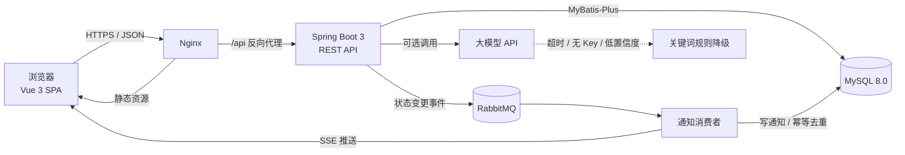
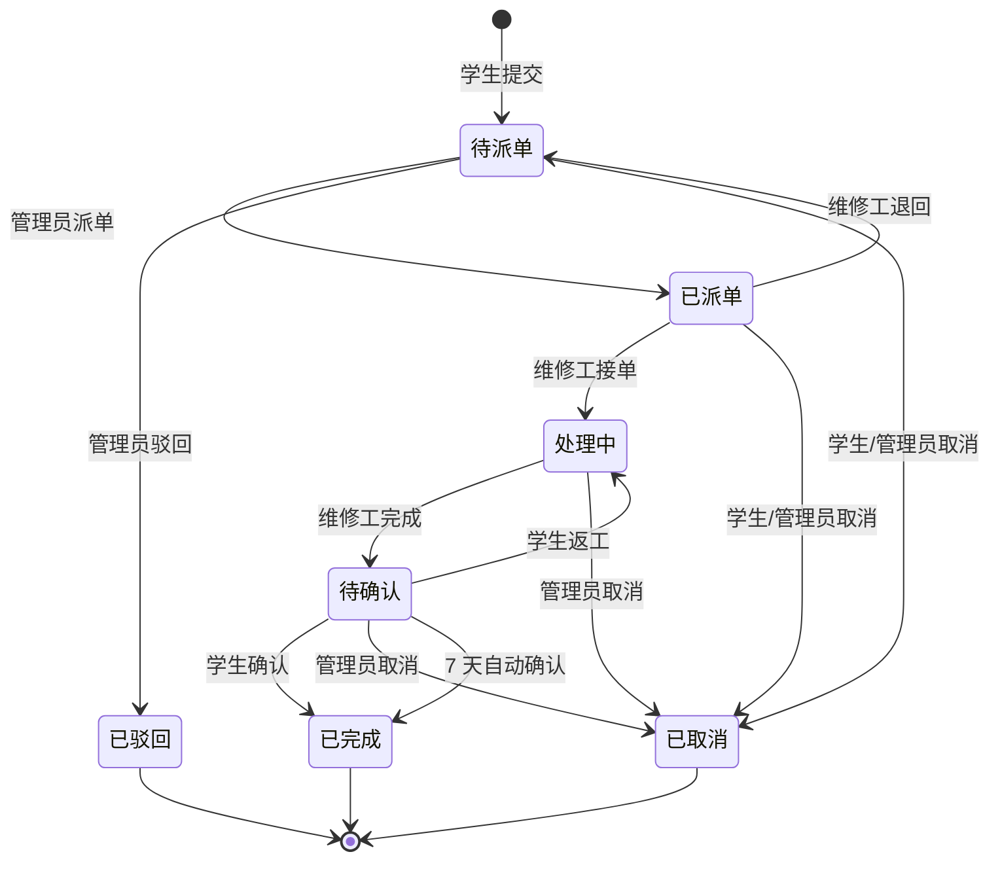
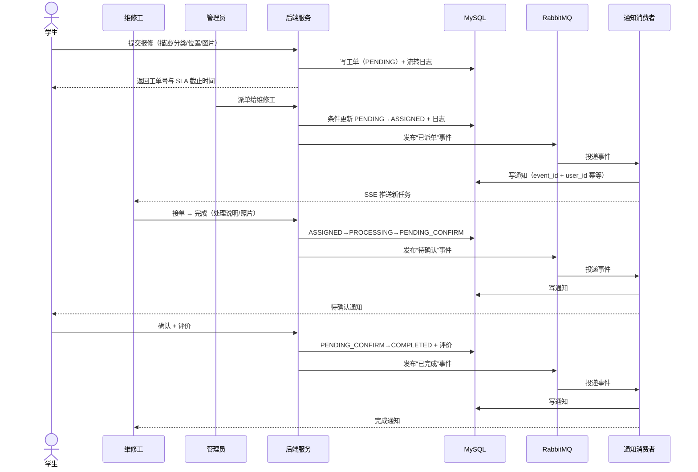
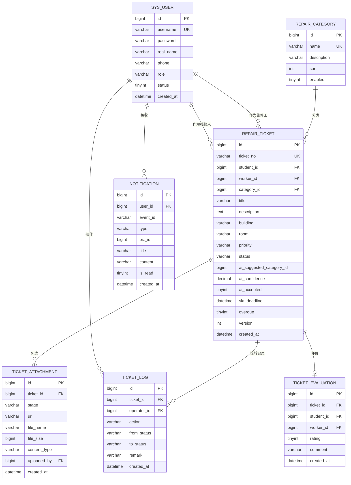

# 校园报修工单与调度平台

## 1 课题说明

### 1.1 选题背景

宿舍、教学楼、实验室的设施故障是校园后勤的高频事项。目前多数报修仍依赖微信群、电话或纸质登记：报修人描述不完整、照片散落在聊天记录里、管理员手工派单、维修进度不透明、超时无人跟进，期末也难以按故障类型、楼栋、维修工进行统计。

本课题面向上述场景，做一个轻量化的前后端分离 Web 应用，把“报修—派单—处理—确认—评价—统计”串成闭环。系统不追求大而全，核心功能控制在 5 个以内，重点把工单状态、权限边界、超时规则和数据统计做扎实。

### 1.2 目标用户与使用场景

| 角色 | 典型场景 | 核心诉求 |
| --- | --- | --- |
| 学生（报修人） | 宿舍水管漏水、门锁损坏、教室空调不制冷、实验室断网 | 少填表单、快速提交、随时看进度、确认完成并评价 |
| 维修工 | 收到派单、上门处理、补传处理前后照片 | 任务清晰、少跑空、处理记录可追溯 |
| 后勤管理员 | 审核报修、派单/改派、催办超时、月度统计 | 全局视图、责任到人、可考核、可导出 |

系统按角色划分数据边界：学生只能看自己提交的工单，维修工只能看派给自己的工单，管理员可以看全量数据。前端路由守卫只负责体验，权限判断以后端为准。

### 1.3 拟解决的问题

1. **报修信息结构化**：用大模型从自然语言描述中预填故障类型、楼栋/房间和紧急程度，减少“分类选错、位置说不清”导致的反复沟通。
2. **派单过程可追踪**：工单状态机约束每一次流转，流转日志记录操作人、时间、前后状态和备注，谁在什么时候做了什么可追溯。
3. **超时可预警**：按优先级设置 SLA，定时扫描即将超时/已超时的工单，自动标记并通知管理员和维修工。
4. **数据可统计**：从工单数据直接生成故障分类分布、工单趋势、平均处理时长、维修工绩效和满意度看板。
5. **权限边界清晰**：三类角色看到的数据不同；派单、接单、完成、确认等操作在后端再次校验角色与资源归属，防止越权。

### 1.4 特色与创新点

- **AI 只做辅助，不替代业务**：AI 输出仅用于表单预填，用户确认后才写入工单；无 API Key、调用超时或输出不合法时，自动退回关键词规则，核心报修流程始终可用。
- **状态机 + 条件更新**：每次流转校验“当前状态 + 操作角色 + 归属关系”，数据库更新带 `status` 与 `version` 条件，避免两个管理员同时派单造成状态覆盖。
- **SLA + 异步通知 + SSE**：超时扫描产生事件，RabbitMQ 异步解耦通知与统计副作用，SSE 实时推送到前端；MQ 不可用时退化为定时扫描 + 站内轮询。
- **统计闭环**：管理员看板直接由工单、流转日志、评价数据聚合，不额外维护报表，答辩时可现场演示数据变化。
- **工程可复现**：Docker Compose 一键启动 MySQL、RabbitMQ、后端和前端；提供建表/初始化 SQL、Swagger 文档、演示账号和 README，教师可在本地复现。

---

## 2 项目框架

### 2.1 技术选型及理由

| 层次 | 选型 |
| --- | --- |
| 前端框架 | Vue 3 + TypeScript + Vite |
| UI/交互 | Element Plus + Tailwind CSS |
| 前端状态/路由 | Pinia + Vue Router |
| 图表 | ECharts |
| 后端框架 | Java + Spring Boot |
| 持久层 | MyBatis-Plus |
| 安全 | Spring Security + JWT |
| 参数校验 | Jakarta Bean Validation |
| 接口文档 | springdoc-openapi |
| 数据库 | MySQL |
| 消息队列 | RabbitMQ |
| AI 调用 | OpenAI 兼容接口（通义千问） |
| 构建 | Maven / npm |
| 部署 | Docker Compose + Nginx |
| 测试 | JUnit 5 + Mockito + MockMvc；Apifox |
| 代码规范 | ESLint + Prettier（前端）；Checkstyle（可选） |
| CI | GitHub Actions（Gitee 镜像提交） |

### 2.2 总体架构




### 2.3 前后端工程结构

**后端 `repair-server`：**

```text
repair-server/
├─ pom.xml
├─ src/main/java/com/BearWhite/repair/
│  ├─ RepairApplication.java
│  ├─ common/                 # Result、PageResult、ErrorCode、BizException、全局异常处理
│  ├─ config/                 # Security、MyBatis-Plus、OpenAPI、RabbitMQ、WebMvc 配置
│  ├─ security/               # JwtUtil、JwtAuthenticationFilter、LoginUser、UserDetailsService
│  ├─ modules/
│  │  ├─ auth/                # 登录、注册、当前用户
│  │  ├─ user/                # 用户/维修工管理
│  │  ├─ category/            # 故障分类
│  │  ├─ ticket/              # 工单实体、DTO/VO、Mapper、Service、Controller、状态机
│  │  ├─ attachment/          # 图片上传与附件
│  │  ├─ notification/        # 通知、SSE、MQ 消费者
│  │  ├─ stats/               # 管理看板统计
│  │  └─ ai/                  # 大模型客户端、提示词、规则降级
│  ├─ mq/                     # 事件定义、RabbitConfig、发布器、死信处理
│  └─ scheduler/              # SLA 扫描、自动确认任务
├─ src/main/resources/
│  ├─ application.yml
│  ├─ application-dev.yml
│  ├─ application-docker.yml
│  ├─ prompts/classify-v1.txt
│  └─ mapper/                 # 复杂统计 SQL（如需要）
├─ src/test/java/...          # 状态机、权限、SLA、AI 降级测试
└─ sql/
   ├─ schema.sql
   └─ data.sql
```

**前端 `repair-web`：**

```text
repair-web/
├─ src/
│  ├─ api/                    # auth、ticket、ai、notification、stats、file
│  ├─ components/             # StatusTag、PriorityTag、ImageUploader、TicketTimeline、EmptyState
│  ├─ layouts/                # AuthLayout、DefaultLayout（侧边栏 + 顶栏 + 通知入口）
│  ├─ router/                 # 路由表与角色守卫
│  ├─ stores/                 # auth、notification
│  ├─ types/                  # 接口与枚举类型
│  ├─ utils/                  # axios 封装、SSE、时间格式化
│  ├─ views/
│  │  ├─ auth/                # LoginView、RegisterView
│  │  ├─ student/             # CreateTicketView、MyTicketsView、TicketDetailView
│  │  ├─ worker/              # MyTasksView、TaskDetailView
│  │  ├─ admin/               # TicketManageView、WorkerManageView、CategoryManageView、DashboardView
│  │  └─ notification/        # NotificationView
│  ├─ App.vue
│  └─ main.ts
├─ vite.config.ts
├─ tailwind.config.js
└─ .env.example
```

### 2.4 开发与运行环境

| 环境项 | 要求 |
| --- | --- |
| JDK | 17 及以上 |
| Maven | 3.9+ |
| Node.js | 20 LTS 及以上 |
| 包管理 | npm（或 pnpm，README 统一一种） |
| 数据库 | MySQL 8.0+，字符集 `utf8mb4` |
| 消息队列 | RabbitMQ 3.12+（可选；无 MQ 时使用 `scheduled` 配置） |
| 容器 | Docker 24+，Docker Compose v2 |
| IDE | IntelliJ IDEA / VS Code |
| 接口调试 | Apifox 或 Postman |
| 版本管理 | Git + Gitee |
| AI 工具 | Zcode |
| 浏览器 | Chrome / Edge 最新版；至少适配 1366×768，并做 390px 窄屏基础适配 |

---

## 3 功能模块设计

### 3.1 模块划分

| 模块 | 职责 | 主要页面/接口 |
| --- | --- | --- |
| 认证与用户 | 登录、学生注册、当前用户、维修工账号管理、启用/禁用 | 登录/注册页；`/api/auth/*`、`/api/admin/workers` |
| 故障分类 | 分类的增删改查与启停；报修表单与 AI 提示词共用 | 分类管理页；`/api/categories` |
| 报修申请 | 创建工单、图片上传、AI 预填、我的工单列表/详情 | 学生端报修页、我的报修 |
| 工单调度 | 管理员全量列表、筛选、派单、驳回、改派 | 工单管理页 |
| 处理与确认 | 维修工接单/退回/完成；学生确认/返工/评价 | 维修工任务页、工单详情页 |
| 通知 | 站内通知、未读数、已读、SSE 实时推送 | 通知中心、顶栏铃铛 |
| 超时预警 | SLA 计算、定时扫描、超时标记、通知 | 定时任务；管理看板超时卡片 |
| 统计看板 | 概览、分类分布、趋势、维修工绩效、满意度 | 管理看板（ECharts） |
| AI 辅助 | 描述分类、位置抽取、紧急度建议、标题摘要、规则降级 | 报修表单“智能预填”按钮 |
| 公共能力 | 统一响应、异常处理、参数校验、Swagger、文件访问、日志追踪 | 全局 |

### 3.2 功能清单

| 编号 | 模块 | 功能 | 角色 | 优先级 | 说明 |
| --- | --- | --- | --- | --- | --- |
| F01 | 认证 | 登录/退出 | 全部 | P0 | 用户名密码登录，JWT 有效期 2 小时，退出清除前端 token |
| F02 | 认证 | 学生注册 | 访客 | P0 | 用户名唯一，密码 BCrypt 加盐哈希；维修工/管理员由管理员创建 |
| F03 | 用户 | 维修工账号管理 | 管理员 | P1 | 新增、启用/禁用、列表筛选；派单时只显示启用状态的维修工 |
| F04 | 分类 | 故障分类管理 | 管理员 | P1 | 新增、编辑、启停、排序；已被工单引用的分类不允许物理删除 |
| F05 | 报修 | 提交报修 | 学生 | P0 | 描述、分类、楼栋/房间、优先级、最多 3 张图片；生成工单号与 SLA 截止时间 |
| F06 | 报修 | AI 智能预填 | 学生 | P1 | 根据描述返回分类/楼栋/房间/紧急度/标题建议；用户确认后才生效 |
| F07 | 报修 | 我的工单 | 学生 | P0 | 分页、按状态/分类/关键词/时间筛选；只能看本人数据 |
| F08 | 调度 | 全量工单管理 | 管理员 | P0 | 分页、组合筛选、查看详情、超时标识 |
| F09 | 调度 | 派单/驳回/改派 | 管理员 | P0 | 状态机约束；派单给启用维修工；驳回需填原因；派单/驳回前二次确认 |
| F10 | 处理 | 接单/退回 | 维修工 | P0 | 只能操作派给自己的工单；退回需填原因，工单回到待派单 |
| F11 | 处理 | 完成工单 | 维修工 | P0 | 填写处理说明，可补传处理照片；进入待确认；提交前二次确认 |
| F12 | 确认 | 确认/返工/评价 | 学生 | P0 | 确认后工单完成；返工回到处理中；完成后可评 1–5 星并留言，一单一评；关键操作二次确认 |
| F13 | 通知 | 站内通知与未读数 | 全部 | P1 | 派单、接单、完成、确认、驳回、超时、返工等事件；支持全部已读 |
| F14 | 通知 | SSE 实时推送 | 全部 | P1 | 通知写入后推送；断线降级为 30 秒轮询未读数 |
| F15 | 超时 | SLA 扫描与预警 | 系统 | P1 | 紧急 4h、普通 24h、低 72h（可配置）；超时标记并通知 |
| F16 | 统计 | 管理看板 | 管理员 | P1 | 概览卡片、分类饼图、30 天趋势、维修工绩效、满意度分布 |
| F17 | 文件 | 图片上传与访问 | 全部 | P0 | jpg/jpeg/png/webp，单张 ≤5MB，单工单 ≤3 张；UUID 文件名 |
| F18 | 公共 | 统一响应/异常/校验/文档 | 全部 | P0 | `code/message/data/traceId`；全局异常；Swagger UI |

### 3.3 核心业务流程图

**图 3-1 工单状态流转图**



**表 3-2 状态流转规则**

| 当前状态 | 动作 | 目标状态 | 允许角色 | 守卫条件 |
| --- | --- | --- | --- | --- |
| `PENDING` | 派单 `ASSIGN` | `ASSIGNED` | 管理员 | 维修工存在且启用；工单未被并发修改 |
| `PENDING` | 驳回 `REJECT` | `REJECTED` | 管理员 | 必须填写驳回原因 |
| `PENDING` | 取消 `CANCEL` | `CANCELLED` | 学生本人/管理员 | 学生只能取消本人工单 |
| `ASSIGNED` | 接单 `ACCEPT` | `PROCESSING` | 被派维修工 | 操作人必须是 `worker_id` |
| `ASSIGNED` | 退回 `DECLINE` | `PENDING` | 被派维修工 | 必须填写退回原因；清空 `worker_id` |
| `ASSIGNED` | 改派 `ASSIGN` | `ASSIGNED` | 管理员 | 新维修工存在且启用；状态不变，更新 `worker_id`；记录 `ASSIGN` 日志 |
| `ASSIGNED` | 取消 `CANCEL` | `CANCELLED` | 学生本人/管理员 | 维修工尚未接单；管理员可取消 |
| `PROCESSING` | 完成 `COMPLETE` | `PENDING_CONFIRM` | 被派维修工 | 必须填写处理说明；可附处理照片 |
| `PROCESSING` | 取消 `CANCEL` | `CANCELLED` | 管理员 | 必须填写取消原因 |
| `PENDING_CONFIRM` | 确认 `CONFIRM` | `COMPLETED` | 学生本人 | 只能确认本人工单；写入 `confirmed_at` |
| `PENDING_CONFIRM` | 返工 `REWORK` | `PROCESSING` | 学生本人 | 必须填写返工原因 |
| `PENDING_CONFIRM` | 取消 `CANCEL` | `CANCELLED` | 管理员 | 必须填写取消原因 |
| `PENDING_CONFIRM` | 自动确认 | `COMPLETED` | 系统 | `completed_at` 超过 7 天且仍未确认 |

**并发控制实现**：所有状态更新使用条件更新，例如：

```sql
UPDATE repair_ticket
SET status = #{toStatus}, version = version + 1, updated_at = NOW()
WHERE id = #{id} AND status = #{fromStatus} AND version = #{version};
```

受影响行数为 0 时返回 `40901 状态已变化，请刷新后重试`。服务层同时校验角色与资源归属，不依赖前端隐藏按钮。

**图 3-2 主业务时序图**



### 3.4 主要用例说明

**UC-01 学生提交报修**

- 参与者：学生
- 前置条件：已登录，账号状态正常。
- 主流程：进入报修页 → 填写描述 →（可选）点击“智能预填” → 系统返回分类/位置/紧急度建议 → 学生确认或修改 → 上传图片 → 提交 → 后端校验分类存在、位置非空、图片数量与类型合法 → 生成工单号、按优先级计算 `sla_deadline` → 写入工单与 `CREATE` 日志 → 返回工单详情。
- 异常/分支：AI 超时或无 Key → 返回 `source=RULE/NONE`，表单不阻塞；分类被禁用 → `40001`；图片超限 → `40001`；重复提交 → 前端按钮防抖 + 后端 3 秒内相同内容提示。

**UC-02 管理员派单**

- 参与者：管理员
- 前置条件：工单状态为 `PENDING`，维修工存在且启用。
- 主流程：管理员在工单管理页筛选 → 打开详情 → 选择维修工 → 确认派单 → 后端校验状态与维修工 → 条件更新为 `ASSIGNED`、写 `ASSIGN` 日志 → 事务提交后发布通知事件 → 维修工收到站内通知/SSE。
- 异常/分支：工单已被其他管理员派单 → `40901`；维修工被禁用 → `40001`；工单已取消 → `40901`。

**UC-03 维修工处理工单**

- 参与者：维修工
- 前置条件：工单已派给当前维修工。
- 主流程：维修工查看“我的任务” → 接单（`ASSIGNED→PROCESSING`）→ 上门处理 → 填写处理说明、上传处理照片 → 完成（`PROCESSING→PENDING_CONFIRM`）→ 学生收到待确认通知。
- 异常/分支：非本人工单 → `40301`；工单已被退回/取消 → `40901`；处理说明为空 → `40001`。

**UC-04 学生确认与评价**

- 参与者：学生
- 前置条件：工单状态为 `PENDING_CONFIRM`，且属于当前学生。
- 主流程：学生查看处理结果 → 确认完成（`PENDING_CONFIRM→COMPLETED`）→ 弹出评价框 → 选择 1–5 星、填写留言 → 提交评价 → 后端校验工单归属、状态、是否已评价 → 写入评价（`ticket_id` 唯一）→ 看板数据更新。
- 异常/分支：返工 → 填写原因，状态回到 `PROCESSING`；重复评价 → `40902`；非本人工单 → `40301`。

**UC-05 超时预警**

- 参与者：系统（定时任务）
- 前置条件：工单处于非终态，且 `sla_deadline < NOW()`。
- 主流程：每分钟扫描 `status NOT IN ('COMPLETED','CANCELLED','REJECTED') AND overdue = 0 AND sla_deadline < NOW()` → 条件更新 `overdue=1, overdue_notified_at=NOW()` → 写 `OVERDUE` 日志 → 通知管理员与维修工 → 看板超时数字增加。
- 异常/分支：并发扫描重复处理 → 条件更新保证只成功一次；MQ 不可用 → 直接写通知表，前端轮询可见。

---

## 4 数据库初步设计

### 4.1 设计原则

- 存储引擎 InnoDB，字符集 `utf8mb4`，排序规则 `utf8mb4_0900_ai_ci`。
- 状态、优先级、角色使用 `VARCHAR` 存储应用枚举，便于扩展，不用 MySQL `ENUM`。
- 核心关系使用物理外键；工单、日志、附件、评价保留历史，不做物理删除。
- `repair_ticket.version` 做乐观锁；状态流转同时带 `status` 条件，双重防止并发覆盖。
- 所有表包含 `created_at`；需要更新的表包含 `updated_at`。
- 查询路径提前建索引：学生列表、维修工列表、管理员筛选、SLA 扫描、通知未读数。
- 图片不存 BLOB，只存 URL/元数据；文件放本地磁盘或对象存储。

### 4.2 E-R 图

**图 4-1 数据库 E-R 图**



> 图中省略了部分审计字段（`updated_at`、`assigned_at` 等）。`notification.event_id` 与 `user_id` 组成唯一键，用于消费幂等；完整字段见 4.3 节。共 7 张表，其中核心业务表 `repair_ticket` 1 张；附件、日志、评价、通知独立成表是为了审计、幂等和统计，均为轻量单表。

### 4.3 数据表说明

#### 表 4-1 用户表 `sys_user`

| 字段 | 类型 | 约束 | 说明 |
| --- | --- | --- | --- |
| `id` | BIGINT | PK, AUTO_INCREMENT | 用户 ID |
| `username` | VARCHAR(50) | NOT NULL, UNIQUE | 登录名 |
| `password` | VARCHAR(100) | NOT NULL | BCrypt 加盐哈希，禁止明文 |
| `real_name` | VARCHAR(50) | NOT NULL | 真实姓名/显示名 |
| `phone` | VARCHAR(20) | NULL | 联系电话，列表脱敏展示 |
| `role` | VARCHAR(20) | NOT NULL | `STUDENT` / `WORKER` / `ADMIN` |
| `status` | TINYINT | NOT NULL, DEFAULT 1 | 1 启用，0 禁用 |
| `created_at` | DATETIME | NOT NULL, DEFAULT CURRENT_TIMESTAMP | 创建时间 |
| `updated_at` | DATETIME | NOT NULL, DEFAULT CURRENT_TIMESTAMP ON UPDATE CURRENT_TIMESTAMP | 更新时间 |

索引：`uk_user_username(username)`、`idx_user_role_status(role, status)`。

#### 表 4-2 故障分类表 `repair_category`

| 字段 | 类型 | 约束 | 说明 |
| --- | --- | --- | --- |
| `id` | BIGINT | PK, AUTO_INCREMENT | 分类 ID |
| `name` | VARCHAR(50) | NOT NULL, UNIQUE | 分类名，如“水电”“门窗”“网络” |
| `description` | VARCHAR(200) | NULL | 分类说明，供 AI 提示词参考 |
| `sort` | INT | NOT NULL, DEFAULT 0 | 排序值，越小越靠前 |
| `enabled` | TINYINT | NOT NULL, DEFAULT 1 | 1 启用，0 停用 |
| `created_at` | DATETIME | NOT NULL, DEFAULT CURRENT_TIMESTAMP | 创建时间 |
| `updated_at` | DATETIME | NOT NULL, DEFAULT CURRENT_TIMESTAMP ON UPDATE CURRENT_TIMESTAMP | 更新时间 |

索引：`uk_category_name(name)`、`idx_category_enabled_sort(enabled, sort)`。

#### 表 4-3 工单表 `repair_ticket`

| 字段 | 类型 | 约束 | 说明 |
| --- | --- | --- | --- |
| `id` | BIGINT | PK, AUTO_INCREMENT | 工单 ID |
| `ticket_no` | VARCHAR(32) | NOT NULL, UNIQUE | 工单号，如 `R20261123153012345` |
| `student_id` | BIGINT | NOT NULL, FK → `sys_user.id` | 报修学生 |
| `worker_id` | BIGINT | NULL, FK → `sys_user.id` | 派单维修工；未派单为空 |
| `category_id` | BIGINT | NOT NULL, FK → `repair_category.id` | 故障分类 |
| `title` | VARCHAR(120) | NOT NULL | 标题，AI 摘要或“分类 + 位置”生成 |
| `description` | TEXT | NOT NULL | 故障描述，10–1000 字 |
| `building` | VARCHAR(50) | NOT NULL | 楼栋，如“3 号楼”“实验楼 B” |
| `room` | VARCHAR(50) | NOT NULL | 房间/位置，如“302”“B-105” |
| `priority` | VARCHAR(20) | NOT NULL, DEFAULT 'NORMAL' | `LOW` / `NORMAL` / `HIGH` |
| `status` | VARCHAR(20) | NOT NULL, DEFAULT 'PENDING' | 见 3.3 状态机 |
| `ai_suggested_category_id` | BIGINT | NULL | AI 建议分类，用于效果评估 |
| `ai_confidence` | DECIMAL(3,2) | NULL | AI 置信度，0–1 |
| `ai_accepted` | TINYINT | NULL | 学生是否采纳 AI 分类：1 是，0 否，NULL 未使用 AI |
| `sla_deadline` | DATETIME | NOT NULL | SLA 截止时间，按优先级计算 |
| `overdue` | TINYINT | NOT NULL, DEFAULT 0 | 是否已超时 |
| `overdue_notified_at` | DATETIME | NULL | 超时通知时间，用于幂等 |
| `assigned_at` | DATETIME | NULL | 派单时间 |
| `accepted_at` | DATETIME | NULL | 接单时间 |
| `completed_at` | DATETIME | NULL | 维修工完成时间 |
| `confirmed_at` | DATETIME | NULL | 学生确认时间 |
| `cancelled_at` | DATETIME | NULL | 取消时间 |
| `version` | INT | NOT NULL, DEFAULT 0 | 乐观锁版本号 |
| `created_at` | DATETIME | NOT NULL, DEFAULT CURRENT_TIMESTAMP | 创建时间 |
| `updated_at` | DATETIME | NOT NULL, DEFAULT CURRENT_TIMESTAMP ON UPDATE CURRENT_TIMESTAMP | 更新时间 |

索引：`uk_ticket_no(ticket_no)`、`idx_ticket_student_status(student_id, status, created_at)`、`idx_ticket_worker_status(worker_id, status, created_at)`、`idx_ticket_status_sla(status, sla_deadline)`、`idx_ticket_category_created(category_id, created_at)`、`idx_ticket_created(created_at)`。

#### 表 4-4 工单附件表 `ticket_attachment`

| 字段 | 类型 | 约束 | 说明 |
| --- | --- | --- | --- |
| `id` | BIGINT | PK, AUTO_INCREMENT | 附件 ID |
| `ticket_id` | BIGINT | NULL, FK → `repair_ticket.id` | 所属工单；上传后未绑定工单时为空 |
| `stage` | VARCHAR(20) | NOT NULL | `TEMP` 待绑定 / `CREATE` 报修图片 / `COMPLETE` 处理图片 |
| `url` | VARCHAR(255) | NOT NULL | 访问路径，如 `/uploads/2026/11/uuid.jpg` |
| `file_name` | VARCHAR(120) | NOT NULL | 原始文件名（展示用，已转义） |
| `file_size` | BIGINT | NOT NULL | 字节数 |
| `content_type` | VARCHAR(100) | NOT NULL | `image/jpeg` 等 |
| `uploaded_by` | BIGINT | NOT NULL, FK → `sys_user.id` | 上传人 |
| `created_at` | DATETIME | NOT NULL, DEFAULT CURRENT_TIMESTAMP | 上传时间 |

索引：`idx_attachment_ticket_stage(ticket_id, stage)`、`idx_attachment_stage_created(stage, created_at)`（清理临时附件）。

> 上传接口先写 `stage='TEMP'`、`ticket_id=NULL` 的附件；创建/完成工单时校验 `uploaded_by` 且 `ticket_id IS NULL` 后绑定并改为 `CREATE/COMPLETE`。超过 24 小时未绑定的 `TEMP` 附件由清理任务删除（可选）。

#### 表 4-5 工单流转日志表 `ticket_log`

| 字段 | 类型 | 约束 | 说明 |
| --- | --- | --- | --- |
| `id` | BIGINT | PK, AUTO_INCREMENT | 日志 ID |
| `ticket_id` | BIGINT | NOT NULL, FK → `repair_ticket.id` | 工单 |
| `operator_id` | BIGINT | NULL, FK → `sys_user.id` | 操作人；系统任务为空 |
| `action` | VARCHAR(30) | NOT NULL | `CREATE/ASSIGN/REJECT/CANCEL/ACCEPT/DECLINE/COMPLETE/CONFIRM/REWORK/AUTO_CONFIRM/OVERDUE` |
| `from_status` | VARCHAR(20) | NULL | 变更前状态；创建时为空 |
| `to_status` | VARCHAR(20) | NOT NULL | 变更后状态 |
| `remark` | VARCHAR(500) | NULL | 原因/处理说明 |
| `created_at` | DATETIME | NOT NULL, DEFAULT CURRENT_TIMESTAMP | 操作时间 |

索引：`idx_log_ticket_created(ticket_id, created_at)`、`idx_log_operator(operator_id)`。

#### 表 4-6 工单评价表 `ticket_evaluation`

| 字段 | 类型 | 约束 | 说明 |
| --- | --- | --- | --- |
| `id` | BIGINT | PK, AUTO_INCREMENT | 评价 ID |
| `ticket_id` | BIGINT | NOT NULL, UNIQUE, FK → `repair_ticket.id` | 一单一评 |
| `student_id` | BIGINT | NOT NULL, FK → `sys_user.id` | 评价学生 |
| `worker_id` | BIGINT | NOT NULL, FK → `sys_user.id` | 被评价维修工 |
| `rating` | TINYINT | NOT NULL | 1–5 星 |
| `comment` | VARCHAR(500) | NULL | 评价内容 |
| `created_at` | DATETIME | NOT NULL, DEFAULT CURRENT_TIMESTAMP | 评价时间 |

索引：`uk_evaluation_ticket(ticket_id)`、`idx_evaluation_worker(worker_id, created_at)`。

#### 表 4-7 通知表 `notification`

| 字段 | 类型 | 约束 | 说明 |
| --- | --- | --- | --- |
| `id` | BIGINT | PK, AUTO_INCREMENT | 通知 ID |
| `user_id` | BIGINT | NOT NULL, FK → `sys_user.id` | 接收人 |
| `event_id` | VARCHAR(64) | NOT NULL | 事件唯一 ID（UUID），与 `user_id` 组成幂等键 |
| `type` | VARCHAR(30) | NOT NULL | `TICKET_ASSIGNED` 等 |
| `biz_id` | BIGINT | NOT NULL | 关联工单 ID |
| `title` | VARCHAR(120) | NOT NULL | 通知标题 |
| `content` | VARCHAR(500) | NOT NULL | 通知内容 |
| `is_read` | TINYINT | NOT NULL, DEFAULT 0 | 0 未读，1 已读 |
| `created_at` | DATETIME | NOT NULL, DEFAULT CURRENT_TIMESTAMP | 创建时间 |

索引：`uk_notification_event_user(event_id, user_id)`（消费幂等）、`idx_notification_user_read(user_id, is_read, created_at)`。

### 4.4 表关系与索引说明

- `sys_user` 与 `repair_ticket` 有两条关系：`student_id`（报修人）和 `worker_id`（维修工），均为多对一。
- `repair_category` 与 `repair_ticket` 是一对多；分类停用后历史工单仍可展示。
- `repair_ticket` 与 `ticket_attachment`、`ticket_log` 是一对多；附件和日志独立成表，便于审计与分阶段展示。
- `ticket_attachment.ticket_id` 允许为空，用于上传后、工单创建前的临时附件；绑定后参与上述一对多关系。
- `repair_ticket` 与 `ticket_evaluation` 是一对一；`ticket_id` 唯一约束保证一单一评。
- `sys_user` 与 `notification` 是一对多；`uk_notification_event_user(event_id, user_id)` 保证同一事件对同一用户只写一条通知，事件对多个接收人可各写一条，MQ 重复消费不会产生重复通知。
- 典型查询与索引对应：
  - 学生“我的报修”：`student_id + status + created_at`；
  - 维修工“我的任务”：`worker_id + status + created_at`；
  - 管理员按状态/分类筛选：`status + category_id + created_at`；
  - SLA 扫描：`status + sla_deadline`；
  - 通知未读数：`user_id + is_read + created_at`。

### 4.5 初始化 SQL 与测试数据

- `sql/schema.sql`：建库、建表、索引、外键；用于空库初始化。
- `sql/data.sql`：演示账号、6 个故障分类、12 条覆盖各状态的工单、评价和通知；用于答辩演示和图表数据。
- 演示账号（密码在 README 中注明，SQL 中存 BCrypt 哈希）：

| 角色 | 用户名 | 密码 | 用途 |
| --- | --- | --- | --- |
| 学生 | `student` | `Student@123` | 提交报修、确认、评价 |
| 维修工 | `worker` | `Worker@123` | 接单、完成 |
| 管理员 | `admin` | `Admin@123` | 派单、驳回、看板 |

- 分类种子数据：水电、门窗、网络、家具、空调电器、其他。
- 工单种子数据覆盖 `PENDING/ASSIGNED/PROCESSING/PENDING_CONFIRM/COMPLETED/CANCELLED/REJECTED`，其中至少 2 条已超时，保证看板有数据。

---

## 5 接口初步设计

### 5.1 RESTful 设计规范

- 基础路径 `/api`，JSON 传输，UTF-8；资源名用复数名词。
- 正确使用 `GET/POST/PUT/DELETE` 与 HTTP 状态码：查询 200，创建 201，删除/无返回 204，参数错误 400，未认证 401，无权限 403，不存在 404，状态冲突 409，限流 429，服务端错误 500。
- 统一响应结构：`{ code, message, data, traceId }`；分页数据放在 `data` 中。
- 分页参数统一为 `page`（从 1 开始）、`size`（默认 10，最大 100）；分页响应统一为 `{ records, total, page, size }`。
- 时间格式 `yyyy-MM-dd HH:mm:ss`，时区 `Asia/Shanghai`。
- 图片上传使用 `multipart/form-data`；单张 ≤5MB，单工单 ≤3 张，格式 jpg/jpeg/png/webp。
- 状态流转接口使用 `PUT`，请求体带原因/备注；后端做条件更新，冲突返回 409。
- AI 预填接口按用户限流，默认 10 次/分钟，超限返回 `42901`。
- Swagger 使用 `@Operation/@Schema` 注解，提供 Bearer Token 调试；接口文档地址 `/swagger-ui/index.html`，OpenAPI JSON `/v3/api-docs`。

### 5.2 统一响应与错误码

```json
{
  "code": 0,
  "message": "success",
  "data": {},
  "traceId": "b7c1f0d2e4a84f0c"
}
```

**表 5-1 错误码**

| 错误码 | HTTP | 含义 | 处理建议 |
| --- | --- | --- | --- |
| `0` | 200/201 | 成功 | — |
| `40001` | 400 | 参数校验失败 | 返回字段级错误信息 |
| `40101` | 401 | 未登录或 token 无效 | 前端跳转登录 |
| `40102` | 401 | token 过期 | 前端清理登录态并跳转 |
| `40301` | 403 | 无权限/越权访问 | 前端提示无权限 |
| `40401` | 404 | 资源不存在 | 返回空状态页 |
| `40901` | 409 | 状态已变化/并发冲突 | 提示刷新后重试 |
| `40902` | 409 | 重复评价 | 提示已评价 |
| `42901` | 429 | AI 调用过于频繁 | 提示稍后再试 |
| `50000` | 500 | 服务端异常 | 记录 traceId，返回统一错误 |
| `50301` | 503 | AI 服务不可用 | 自动降级规则；前端提示“已使用本地规则” |

### 5.3 核心接口清单

**表 5-2 核心接口清单**

| 模块 | 方法 | 路径 | 角色 | 主要参数 | 返回 | 说明 |
| --- | --- | --- | --- | --- | --- | --- |
| 认证 | POST | `/api/auth/login` | 公开 | `username, password` | `token, user` | 登录 |
| 认证 | POST | `/api/auth/register` | 公开 | `username, password, realName, phone` | `user` | 学生注册 |
| 认证 | GET | `/api/auth/me` | 已登录 | — | `user` | 当前用户 |
| 分类 | GET | `/api/categories` | 已登录 | `enabled=true` | `list` | 启用分类 |
| 分类 | POST | `/api/admin/categories` | 管理员 | `name, description, sort` | `category` | 新增分类 |
| 分类 | PUT | `/api/admin/categories/{id}` | 管理员 | `name, description, sort, enabled` | `category` | 编辑/启停 |
| 分类 | DELETE | `/api/admin/categories/{id}` | 管理员 | — | — | 仅未被引用时允许 |
| 用户 | GET | `/api/admin/workers` | 管理员 | `page, size, keyword, status` | `page<user>` | 维修工列表 |
| 用户 | POST | `/api/admin/workers` | 管理员 | `username, password, realName, phone` | `user` | 创建维修工 |
| 用户 | PUT | `/api/admin/users/{id}/status` | 管理员 | `status` | — | 启用/禁用 |
| 文件 | POST | `/api/files` | 已登录 | `file` | `id, url` | 上传图片，写 TEMP 附件 |
| 报修 | POST | `/api/tickets` | 学生 | `title, description, categoryId, building, room, priority, attachmentIds` | `ticket` | 创建工单并绑定 TEMP 附件 |
| 报修 | GET | `/api/tickets` | 全部 | `page, size, status, categoryId, keyword, startDate, endDate` | `page<ticket>` | 按角色返回数据 |
| 报修 | GET | `/api/tickets/{id}` | 全部 | — | `ticketDetail` | 详情（含日志/附件/评价） |
| 调度 | PUT | `/api/tickets/{id}/assign` | 管理员 | `workerId` | `ticket` | 派单/改派 |
| 调度 | PUT | `/api/tickets/{id}/reject` | 管理员 | `reason` | `ticket` | 驳回 |
| 调度 | PUT | `/api/tickets/{id}/cancel` | 学生/管理员 | `reason` | `ticket` | 取消 |
| 处理 | PUT | `/api/tickets/{id}/accept` | 维修工 | — | `ticket` | 接单 |
| 处理 | PUT | `/api/tickets/{id}/decline` | 维修工 | `reason` | `ticket` | 退回 |
| 处理 | PUT | `/api/tickets/{id}/complete` | 维修工 | `remark, attachmentIds` | `ticket` | 完成并绑定处理图片 |
| 确认 | PUT | `/api/tickets/{id}/confirm` | 学生 | — | `ticket` | 确认完成 |
| 确认 | PUT | `/api/tickets/{id}/rework` | 学生 | `reason` | `ticket` | 返工 |
| 确认 | POST | `/api/tickets/{id}/evaluation` | 学生 | `rating, comment` | `evaluation` | 评价（一单一评） |
| 日志 | GET | `/api/tickets/{id}/logs` | 全部 | — | `list<log>` | 流转时间线 |
| AI | POST | `/api/ai/classify` | 学生 | `description` | `suggestion, source, confidence` | 智能预填，限流 |
| 通知 | GET | `/api/notifications` | 已登录 | `page, size, isRead` | `page<notification>` | 通知列表 |
| 通知 | PUT | `/api/notifications/{id}/read` | 已登录 | — | — | 标记已读 |
| 通知 | PUT | `/api/notifications/read-all` | 已登录 | — | — | 全部已读 |
| 通知 | GET | `/api/notifications/stream` | 已登录 | — | `text/event-stream` | SSE 实时通知 |
| 统计 | GET | `/api/admin/stats/overview` | 管理员 | — | `overview` | 概览卡片 |
| 统计 | GET | `/api/admin/stats/category` | 管理员 | `startDate, endDate` | `list` | 分类分布 |
| 统计 | GET | `/api/admin/stats/trend` | 管理员 | `days=30` | `list` | 工单趋势 |
| 统计 | GET | `/api/admin/stats/workers` | 管理员 | `startDate, endDate` | `list` | 维修工绩效 |
| 统计 | GET | `/api/admin/stats/satisfaction` | 管理员 | `startDate, endDate` | `distribution, avg` | 满意度 |

> 完整接口以 Swagger 文档为准；上表为核心接口，省略了健康检查、Swagger 等基础设施接口。

### 5.4 关键接口示例

**1）登录**

```http
POST /api/auth/login
Content-Type: application/json

{
  "username": "student",
  "password": "Student@123"
}
```

```json
{
  "code": 0,
  "message": "success",
  "data": {
    "token": "eyJhbGciOiJIUzI1NiJ9...",
    "user": {
      "id": 1,
      "username": "student",
      "realName": "张同学",
      "role": "STUDENT"
    }
  },
  "traceId": "b7c1f0d2e4a84f0c"
}
```

**2）AI 智能预填**

```http
POST /api/ai/classify
Authorization: Bearer <token>
Content-Type: application/json

{
  "description": "3号楼302卫生间水管爆了，一直在漏水，地上全是水"
}
```

```json
{
  "code": 0,
  "message": "success",
  "data": {
    "categoryId": 1,
    "categoryName": "水电",
    "building": "3号楼",
    "room": "302",
    "priority": "HIGH",
    "title": "3号楼302 卫生间水管漏水",
    "confidence": 0.91,
    "source": "AI"
  },
  "traceId": "1f2a3b4c5d6e7f80"
}
```

> `source` 取值：`AI` 大模型、`RULE` 关键词规则、`NONE` 无建议。无 Key 或调用失败时返回 `RULE/NONE`，HTTP 仍为 200，不阻塞报修。

**3）创建工单**

```http
POST /api/tickets
Authorization: Bearer <student-token>
Content-Type: application/json

{
  "title": "3号楼302 卫生间水管漏水",
  "description": "3号楼302卫生间水管爆了，一直在漏水，地上全是水",
  "categoryId": 1,
  "building": "3号楼",
  "room": "302",
  "priority": "HIGH",
  "attachmentIds": [101, 102]
}
```

```json
{
  "code": 0,
  "message": "success",
  "data": {
    "id": 1001,
    "ticketNo": "R20261123153012345",
    "status": "PENDING",
    "priority": "HIGH",
    "slaDeadline": "2026-11-23 19:30:12",
    "createdAt": "2026-11-23 15:30:12"
  },
  "traceId": "2a3b4c5d6e7f8091"
}
```

**4）派单（并发冲突示例）**

```http
PUT /api/tickets/1001/assign
Authorization: Bearer <admin-token>
Content-Type: application/json

{
  "workerId": 2
}
```

成功返回 200 与更新后的工单；若工单已被其他管理员派单或状态已变化：

```json
{
  "code": 40901,
  "message": "工单状态已变化，请刷新后重试",
  "data": null,
  "traceId": "3b4c5d6e7f80912a"
}
```

**5）工单分页查询**

```http
GET /api/tickets?page=1&size=10&status=PENDING&categoryId=1&keyword=漏水
Authorization: Bearer <admin-token>
```

```json
{
  "code": 0,
  "message": "success",
  "data": {
    "records": [
      {
        "id": 1001,
        "ticketNo": "R20261123153012345",
        "title": "3号楼302 卫生间水管漏水",
        "categoryName": "水电",
        "building": "3号楼",
        "room": "302",
        "priority": "HIGH",
        "status": "PENDING",
        "overdue": false,
        "createdAt": "2026-11-23 15:30:12"
      }
    ],
    "total": 1,
    "page": 1,
    "size": 10
  },
  "traceId": "4c5d6e7f80912a3b"
}
```

**6）管理看板概览**

```http
GET /api/admin/stats/overview
Authorization: Bearer <admin-token>
```

```json
{
  "code": 0,
  "message": "success",
  "data": {
    "total": 128,
    "pending": 12,
    "processing": 9,
    "pendingConfirm": 5,
    "completedToday": 7,
    "overdue": 3,
    "avgHandleHours": 6.4,
    "avgRating": 4.6
  },
  "traceId": "5d6e7f80912a3b4c"
}
```

### 5.5 鉴权与数据边界

- JWT 载荷包含 `userId`、`username`、`role`，有效期 2 小时；前端在请求头带 `Authorization: Bearer <token>`。
- 接口用 `@PreAuthorize("hasRole('ADMIN')")` 等注解做角色级鉴权；Service 层再校验资源归属：
  - 学生：`ticket.studentId == currentUserId`；
  - 维修工：`ticket.workerId == currentUserId`；
  - 管理员：全量。
- 列表查询在 SQL 层拼接角色条件，不把全量数据查到内存再过滤。
- 前端路由守卫与按钮隐藏只用于体验；直接调用接口时后端必须返回 403。
- 图片文件名使用 UUID，禁止 `../` 等路径穿越；上传做 MIME/扩展名/大小白名单。演示环境通过 `/uploads/**` 静态访问，生产可替换为带签名的对象存储 URL。
- 上传附件先写 `TEMP` 记录；创建/完成工单时校验 `uploaded_by=currentUser` 且 `ticket_id IS NULL`，绑定后才可展示；禁止把他人附件挂到自己的工单。
- 持久层使用 MyBatis-Plus 参数绑定（`#{}`），禁止用 `${}` 拼接用户输入；描述、备注等文本在输出时转义，Vue 默认插值转义，防止 SQL 注入与 XSS；如引入富文本，使用白名单过滤。
- SSE 前端使用 `fetch` + `ReadableStream` 读取并携带 `Authorization` 头（`EventSource` 不支持自定义请求头），避免 token 出现在 URL；断线后重连，失败降级为轮询。
- 日志不打印密码、token、完整手机号；AI 调用日志对手机号等个人信息做脱敏。

---

## 6 开发计划与风险预案

### 6.1 阶段计划

**表 6-1 阶段计划**

| 阶段 | 时间 | 主要工作 | 交付物/验收点 |
| --- | --- | --- | --- |
| S0 选题与设计 | 2026-11-23 — 2026-12-03 | 定题、需求边界、E-R/接口设计、初始工程、Gitee 仓库（公开或对教师开放） | 本设计文档、初始前后端工程、README、12-04 提交审核 |
| S1 基础能力 | 2026-12-04 — 2026-12-12 | 前后端脚手架、Docker Compose、登录/JWT、用户/分类、图片上传 | 三角色可登录；分类/维修工可管理；图片可上传展示 |
| S2 核心工单 | 2026-12-13 — 2026-12-24 | 工单创建、列表/详情、状态机、派单/接单/完成/确认/返工/评价 | 一条工单可完整走通；越权与并发冲突返回 403/409 |
| S3 增强能力 | 2026-12-25 — 2027-01-02 | AI 预填 + 规则降级 + 评测、SLA 扫描、通知/SSE、RabbitMQ、看板 | AI 无 Key 可用；超时可见；MQ 通知可重试；看板有图 |
| S4 收尾与部署 | 2027-01-03 — 2027-01-06 | 单测/接口测试、README、SQL、Swagger、Docker 部署、演示数据 | 教师按 README 可复现；核心用例全部通过 |
| S5 报告与答辩 | 2027-01-07 — 2027-01-09 | 报告、截图/录屏、答辩 PPT、演示脚本 | 01-09 提交报告并答辩 |

### 6.2 难点预估与对策

**表 6-2 风险与对策**

| 难点/风险 | 具体表现 | 对策 |
| --- | --- | --- |
| 状态机并发 | 两个管理员同时派单，后写覆盖先写 | 条件更新 `WHERE status=? AND version=?`；受影响行数为 0 返回 409；写并发测试 |
| SLA 幂等 | 定时任务重复扫描，重复通知 | `overdue=0` 条件更新 + `overdue_notified_at`；扫描每分钟一次，按 `status+sla_deadline` 索引 |
| AI 输出不稳定 | 返回非 JSON、分类不存在、置信度低、超时 | JSON Schema 校验 + 分类白名单 + 置信度阈值 0.6；超时 3 秒、重试 1 次；失败走关键词规则；规则失败返回 `NONE` |
| 无 AI Key 环境 | 教师机器无法调用大模型 | AI 完全可选；`.env` 不配 Key 时启动即规则模式，报修流程不受影响 |
| MQ 可靠性 | 消息丢失、重复消费、消费者异常 | 事务提交后发布；消费者按 `(event_id, user_id)` 幂等；失败重试 3 次后进死信队列；发布失败降级直写通知表；提供 `scheduled` 降级 |
| 文件上传与绑定 | 伪造扩展名、超大文件、路径穿越、他人附件 | MIME + 扩展名白名单、5MB 限制、UUID 重命名、路径规范化；上传写 TEMP，绑定校验 `uploaded_by` 与未绑定状态 |
| 越权访问 | 学生改 URL 看他人工单 | Service 层归属校验；列表 SQL 带角色条件；403 负例测试 |
| 前端角色路由 | 只隐藏菜单，接口仍可调 | 后端为唯一权限源；前端守卫仅做跳转；Apifox 直接调接口验证 |
| 时间不足 | 增强项挤占核心闭环 | 按 6.3 顺序降级；P0 功能优先，P1 可裁剪；每周检查进度 |

### 6.3 简化与降级方案

按以下顺序裁剪，保证核心闭环可演示：

1. **RabbitMQ → 定时/同步通知**：保留通知表与未读数，去掉 MQ 依赖；`app.notify.mode=scheduled`。
2. **SSE → 30 秒轮询**：保留通知中心，顶栏未读数轮询；`app.notify.sse=false`。
3. **AI → 纯规则**：保留“智能预填”按钮，返回 `source=RULE`；不配置大模型 Key。
4. **公网部署 → 本地 Docker Compose**：答辩用本机 `docker compose up -d` 演示，README 保留云服务器部署说明。
5. **图表 → 2 个核心图**：保留分类饼图与 30 天趋势；维修工绩效/满意度可先用表格。
6. **图片存储 → 本地磁盘**：不引入 MinIO/OSS；保留接口抽象，后续可替换。

### 6.4 测试与验收

| 测试类型 | 覆盖内容 | 工具/方式 |
| --- | --- | --- |
| 单元测试 | 状态流转合法性、SLA 计算、AI 规则降级、归属校验 | JUnit 5 + Mockito |
| 接口测试 | 登录、创建、派单、接单、完成、确认、评价、403/409/400 负例 | MockMvc + Apifox |
| 并发测试 | 同一工单并发派单/并发确认，只有一条成功 | JMeter 或 Apifox 并发请求 |
| 前端验收 | 1366×768 与 390px 窄屏；加载/空数据/错误提示；表单校验；图片预览；列表/弹窗过渡；关键操作二次确认 | Chrome DevTools |
| 部署验收 | 空机器按 README 启动；SQL 初始化；演示账号可登录 | Docker Compose |
| AI 评测 | 30–50 条标注描述，统计分类准确率、降级率、P95 延迟 | 离线脚本/测试用例，结果写入报告 |

**核心验收清单：**

- [ ] 学生可注册/登录，提交带图片的报修，看到自己的工单列表与详情。
- [ ] 管理员可筛选工单、派单、驳回；维修工可接单、完成；学生可确认、返工、评价。
- [ ] 学生看不到他人工单，维修工看不到未派给自己的工单，越权返回 403。
- [ ] 同一工单并发派单只有一次成功，另一次返回 409。
- [ ] 超时工单在看板标记，管理员/维修工收到通知。
- [ ] 无 AI Key 时智能预填返回规则结果，报修流程不受影响。
- [ ] 管理看板展示分类分布、趋势、处理时长、满意度。
- [ ] `docker compose up -d` 后按 README 可完成演示；Swagger 可访问。

---

## 7 AI 工具使用计划

### 7.1 工具与分工

**表 7-1 AI 工具使用计划**

| 环节 | 工具 | 用途 | 人工把关 |
| --- | --- | --- | --- |
| 需求澄清 | Zcode | 根据任务书生成用例清单、边界条件、验收标准草案 | 本人确认范围，删除超纲功能 |
| 设计 | Zcode | 生成 E-R、接口清单、状态机草案 | 本人检查范式、约束、权限与索引 |
| 脚手架 | Zcode | 生成前后端目录、依赖、Docker Compose、CI 配置 | 本人核对版本与启动命令 |
| 编码 | Zcode | 生成 DTO/VO、Mapper、CRUD、Vue 页面骨架 | 核心状态机、权限、SQL、AI 降级逐行审查 |
| 测试 | Zcode | 生成 JUnit/MockMvc 用例、边界数据 | 本人补充并发、越权、异常分支 |
| 代码审查 | Zcode | 对 diff 做安全/一致性检查 | 本人决定是否采纳，保留审查记录 |
| 文档 | Zcode | 生成 README、报告初稿、接口说明 | 本人核对事实、截图、数字 |
| 产品内 AI | deepseek（OpenAI 兼容） | 报修描述分类/位置/紧急度/标题 | 规则降级 + 用户确认，不自动落库 |

### 7.2 关键提示词策略

- 每次给 AI 的上下文包含：技术栈、目录结构、模块边界、接口契约、验收标准、禁止事项（不引 JSP/Thymeleaf、不把业务数据放 localStorage、不绕过权限）。
- 要求 AI 先给方案再写代码；核心逻辑要求附测试；无测试的生成结果不接收。
- 要求 AI 解释 diff 与影响范围；本人按“接口契约—数据流—安全—异常”四层审查。
- 提示词与关键决策记录到 `docs/ai-log.md`，字段：日期、阶段、工具、提示词摘要、产出摘要、人工修改/决策、关联 commit。
- 不在提示词中粘贴真实 token、密码、手机号等敏感信息；示例数据使用虚构值。

### 7.3 记录与可追溯

- Git 提交按阶段拆分：`feat(auth)`、`feat(ticket)`、`feat(ai)`、`test(ticket)`、`docs(readme)`；提交信息可读。
- 关键 AI 协作场景保留 3–5 组“提示词 → 生成结果 → 人工修改 → 最终代码”的对照，写入报告第 8 章。
- 每次 AI 生成的核心代码在合并前跑测试；失败则回到提示词或手写修复，记录原因。
- 报告中的 AI 使用说明与仓库 `docs/ai-log.md` 一致，避免“只写结论、没有过程”。

### 7.4 预期效果与边界

- **预期效果**：减少脚手架、DTO、CRUD、前端表单等重复劳动，把时间留给状态机、权限、并发、SLA、AI 降级和测试；代码风格与注释更统一；报告有真实的 AI 协作过程可讲。
- **边界**：AI 生成代码必须能解释、能修改、能测试；核心业务逻辑与安全相关代码由本人审查；AI 不替代需求判断和最终验收。
- **评测口径**：AI 分类效果用 30–50 条标注描述单独评测，目标 Top-1 分类准确率 ≥85%，无 Key 时规则降级可用率 100%；报告中写清样本量、准确率、降级率和 P95 延迟，实际数字以评测结果为准。
